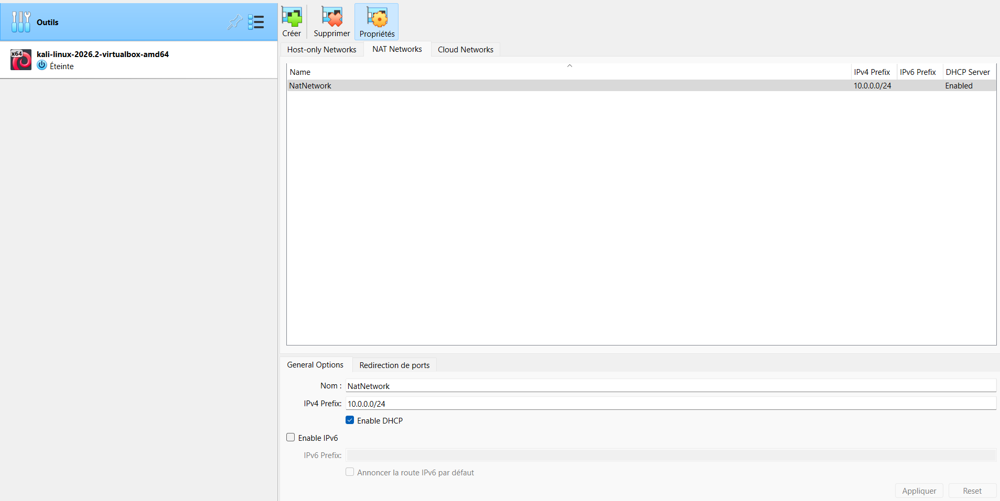
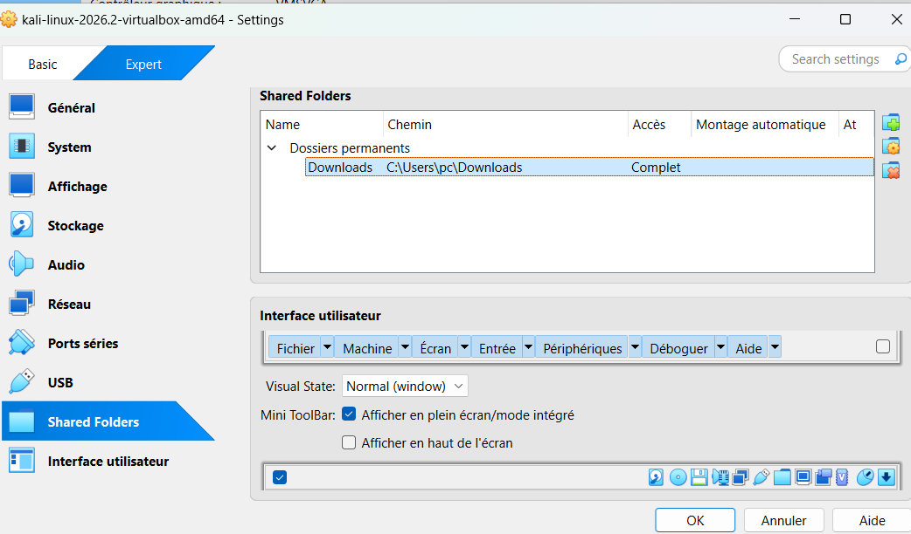

# NETWORKWALKS-ROSEMARY-B084-WK1-PM1-CYBERSECURITY-LAB-SETUP
# Cybersecurity Lab Environment Setup

Building an isolated virtual lab for penetration testing and ethical hacking practice.

**Intern:** Rose Mary | **Batch:** B084 | **Project:** WK1-PM1 | **Program:** Networkwalks Cybersecurity

## Project Overview
This project sets up a virtual cybersecurity lab using VirtualBox and Kali Linux. The lab runs on a private NAT Network so more machines can be added later and used as targets for authorized security testing. It is for education and practice in my own lab environment only.

## Lab Specifications
| Item | Value |
|---|---|
| Virtualization | VirtualBox (version: XXXX) |
| Attacker machine | Kali Linux 2026.2 |
| Network type | NAT Network (NatNetwork) |
| Subnet | 10.0.0.0/24 (DHCP enabled) |
| Kali IP | 10.0.0.2/24 |
| Gateway / DNS | 10.0.0.1 / 8.8.8.8 |
| Shared clipboard & drag/drop | Bidirectional |
| Shared folder | Host Downloads folder |

## Steps Completed
1. **VirtualBox:** Installed the latest version. 
2. **NAT Network:** Created NatNetwork with prefix 10.0.0.0/24 and DHCP enabled. 
3. **Kali network adapter:** Adapter 1 attached to NAT Network "NatNetwork", Promiscuous Mode set to Allow All. 
4. **Clipboard and drag-and-drop:** Set to Bidirectional in General > Advanced. 
5. **Shared folder:** Added the host Downloads folder with Auto-mount. 
6. **Static IP:** Configured 10.0.0.2/24, gateway 10.0.0.1, DNS 8.8.8.8. 
7. **Verification:** `ip a` shows 10.0.0.2/24. 
8. **Internet test:** Pinged 8.8.8.8 and google.com successfully. 
9. **Snapshot:** Took snapshot "Clean Kali Setup Lab". 

## Troubleshooting
**Problem:** In Kali, clicking "Wired connection 1" in Edit Connections did nothing, so I could not set the static IP from the GUI.

**Solution:** I configured it from the terminal with `nmcli`:
```bash
sudo nmcli connection modify "Wired connection 1" ipv4.method manual ipv4.addresses 10.0.0.2/24 ipv4.gateway 10.0.0.1 ipv4.dns 8.8.8.8
sudo nmcli connection modify "Wired connection 1" ipv4.dad-timeout 0
sudo nmcli connection down "Wired connection 1"
sudo nmcli connection up "Wired connection 1"
```
Then I verified with `ip a` and `ping`. If the connection name differs, run `nmcli connection show` to find it. `nmtui` is another option.

## Key Learnings
- How NAT Networks isolate a lab from the host network
- Setting static IPs on Kali with NetworkManager (`nmcli`)
- Using snapshots to save a clean, restorable state

## Disclaimer
This lab is for educational use on my own devices only. Unauthorized access to systems is illegal.
